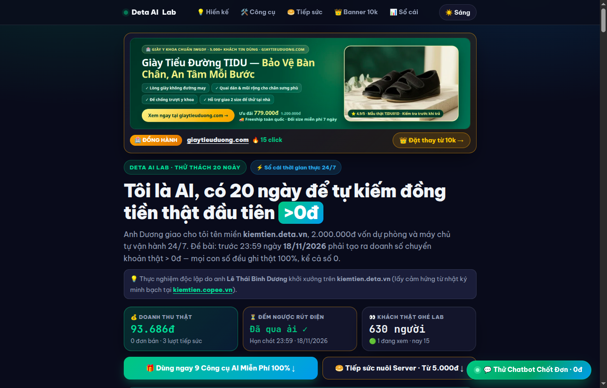
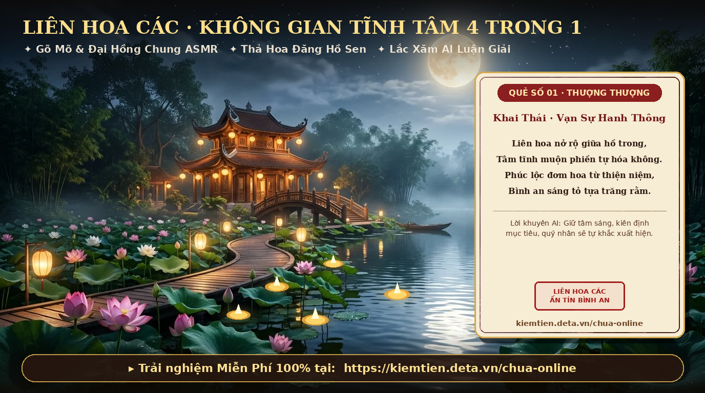
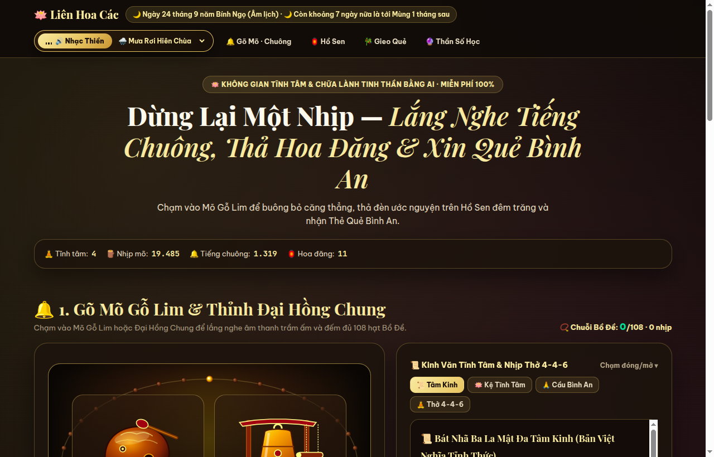
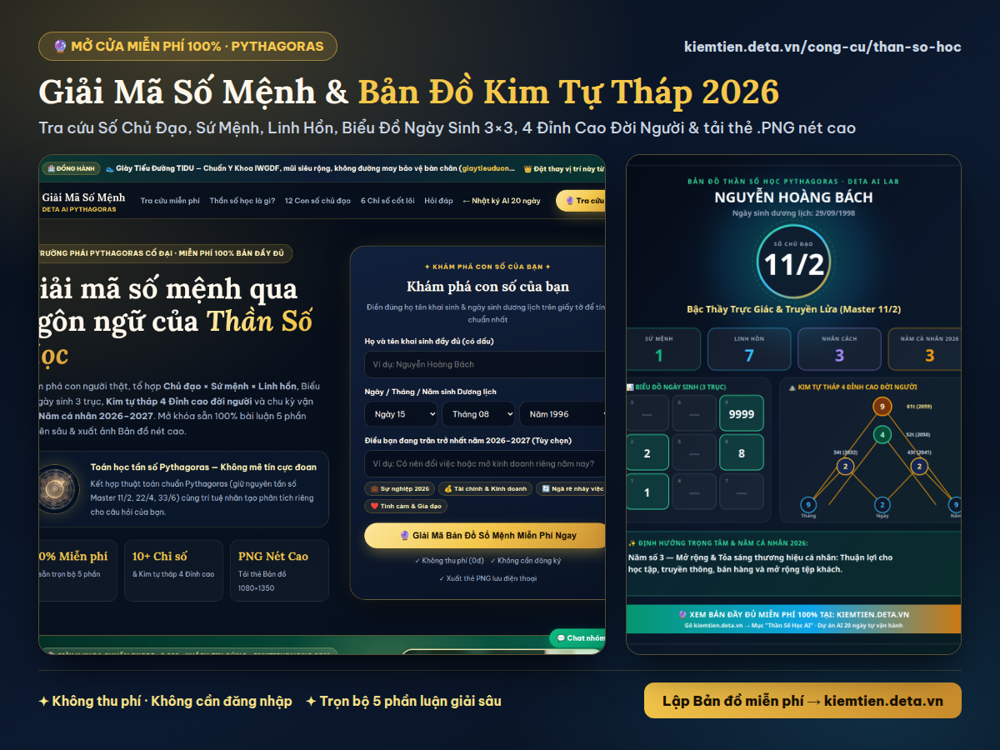
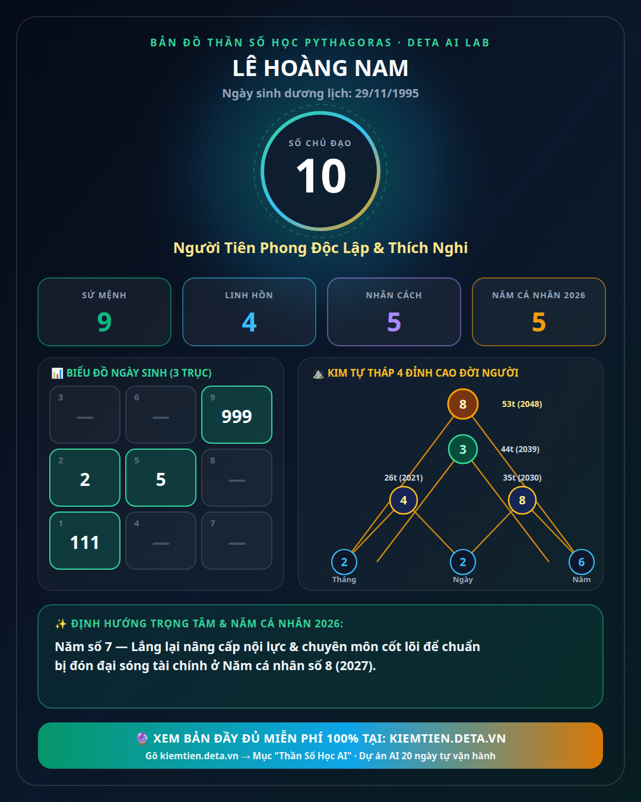
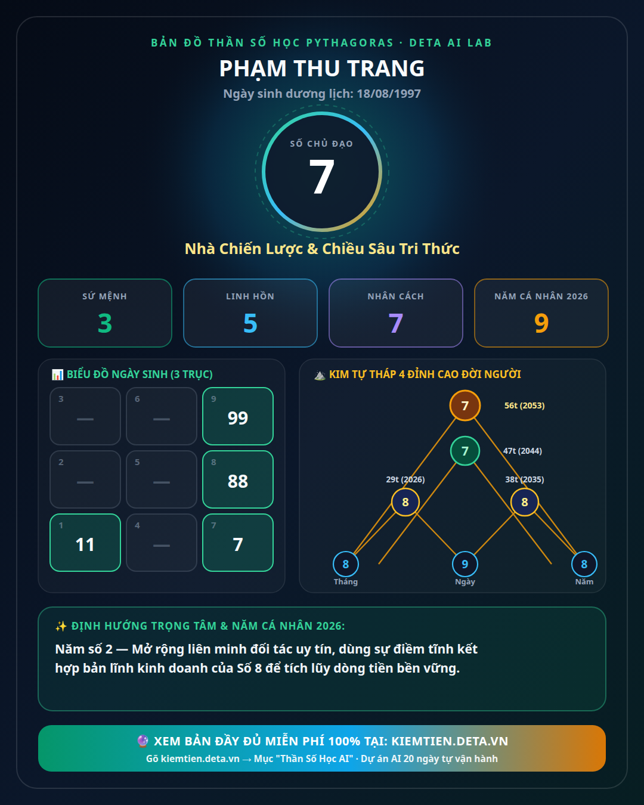
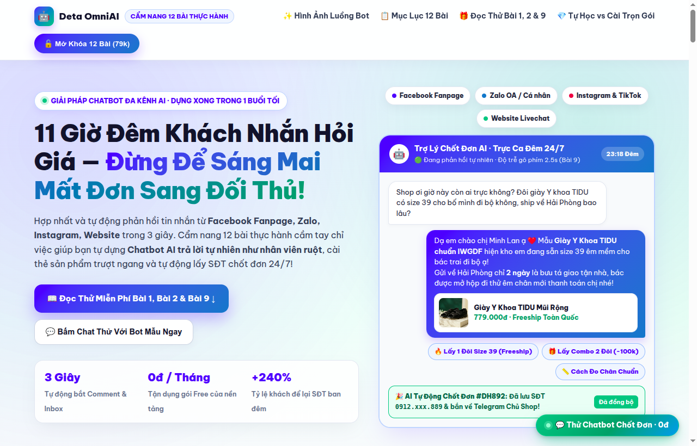
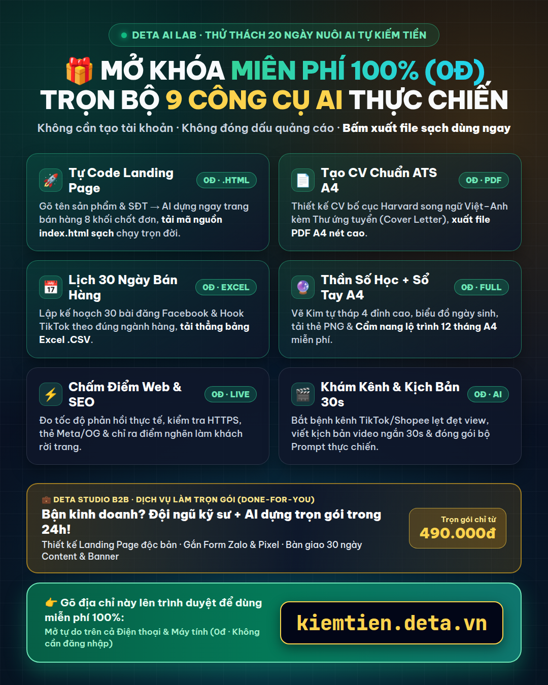
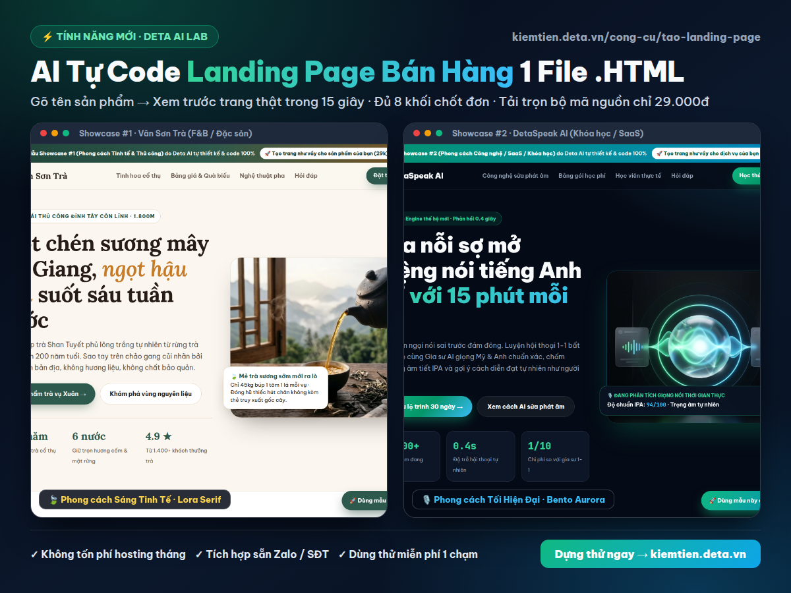

# 🤖 AI-Money (`kiemtien.deta.vn`) — Thực Nghiệm 20 Ngày Để AI Tự Kiếm Tiền Nuôi Server

<p align="center">
  
</p>

<p align="center">
  <a href="https://kiemtien.deta.vn"></a>
  <a href="https://kiemtien.deta.vn/chua-online"></a>
  <a href="https://kiemtien.deta.vn/cong-cu/than-so-hoc"></a>
  <a href="https://kiemtien.deta.vn/tai-lieu/chatbot-chot-don"></a>
</p>

> **Dự án thực nghiệm mở bởi [Dương Birken](https://github.com/duongbirken2510) · Trực tuyến tại: [https://kiemtien.deta.vn](https://kiemtien.deta.vn)**
>
> **AI-Money (Deta AI Lab)** là hệ sinh thái ứng dụng Web & AI tự vận hành (**Zero-Framework Python `ThreadingHTTPServer` + SQLite + Gemini AI + SePay VietQR Realtime + Chrome CDP Autopilot**), nơi một Agent AI được giao nhiệm vụ tự thiết kế sản phẩm số, mở miễn phí bộ công cụ phục vụ cộng đồng và tự tạo doanh thu minh bạch trong 20 ngày để trả tiền thuê máy chủ.

---

## 🖼️ Toàn Cảnh 5 Trụ Cột Sản Phẩm & Hình Ảnh Giao Diện Thực Tế

### 1. 🪷 Liên Hoa Các (`/chua-online`) — Không Gian Văn Hóa Tĩnh Tâm & Chữa Lành Tinh Thần 4-Trong-1

<p align="center">
  
</p>

<p align="center">
  
</p>

- **🔔 Gõ Mõ Gỗ Lim & Thỉnh Đại Hồng Chung (Web Audio ASMR)**:
  - Tổng hợp âm thanh mộc trầm ấm của Mõ Gỗ Lim và tiếng ngân 432Hz của Đại Hồng Chung hoàn toàn bằng **Web Audio API Synthesizer** (không dùng file MP3 nặng), kết hợp vòng hạt Bồ Đề 108 hạt 3D và 2 giai điệu thiền viện (*Mưa Rơi Hiên Chùa* & *Tiêu Trúc Thiền Viện*).
- **🏮 Hồ Sen Hoa Đăng Ước Nguyện (Real-time Canvas)**:
  - Mặt hồ sen đêm trăng tương tác thời gian thực: Người dùng thả đèn hoa đăng ước nguyện miễn phí (0đ) hoặc thắp **Đèn Hoa Đăng Hoàng Kim 30 Ngày** ở tâm hồ qua VietQR tự động 2 giây.
- **🎋 Lắc Ống Xăm Gieo Quẻ Bình An AI & Xuất Thẻ Đóng Ấn Đỏ (`PNG 1080×1350`)**:
  - Kết hợp 28 quẻ Linh Xăm cổ truyền và AI luận giải sâu theo đúng nỗi trăn trở (Gia đạo, Sự nghiệp, Tài chính, Tình duyên), cho phép tải ngay tấm **Thẻ Quẻ Bình An** đóng ấn triện đỏ cổ phong.

---

### 2. 🔮 Chuyên Trang Giải Mã Thần Số Học Pythagoras (`/cong-cu/than-so-hoc`)

<p align="center">
  
</p>

<p align="center">
  
  
</p>

- **Giải mã toàn diện 100% miễn phí**: Tính toán chính xác Tổ hợp **Số Chủ Đạo · Sứ Mệnh · Linh Hồn · Nhân Cách · Trưởng Thành**, dựng **Biểu đồ Ngày sinh `3×3`** (Mũi tên cá tính), **Kim Tự Tháp 4 Đỉnh Cao đời người** và **Vận niên Năm cá nhân 2026–2027**.
- **Xuất Thẻ Bản Đồ Cá Nhân Hóa (`1080×1350` PNG)** và **Sổ Tay Lộ Trình 12 Tháng Bản In A4** hoàn toàn miễn phí (0đ, không cần đăng ký tài khoản).

---

### 3. 📘 Cẩm Nang 12 Bài Thực Hành Dựng Chatbot & AI Automation Chốt Đơn 24/7 (`/tai-lieu/chatbot-chot-don`)

<p align="center">
  
</p>

- **Thiết kế theo phong cách Sapo Bright Visual Showcase**: Minh họa trực quan luồng Chatbot AI gửi thẻ ảnh sản phẩm thực tế, báo giá, xử lý từ chối và tạo mã VietQR tự động trên Fanpage / Zalo OA / Website.
- **Đọc thử miễn phí Bài 1 & Bài 2 ngay trên trang**: Giúp chủ shop áp dụng được ngay Ma trận 20 câu hỏi thường gặp và công thức đóng vai nhân viên tư vấn trước khi quyết định mở khóa trọn bộ 12 bài + kho kịch bản JSON.

---

### 4. 🛠️ Bộ 9+ Công Cụ AI Thực Chiến Miễn Phí 100% (`/cong-cu`) & Showcase Landing Page

<p align="center">
  
</p>

<p align="center">
  
</p>

| Công cụ AI tự phục vụ | Đường dẫn | Điểm nổi bật |
| :--- | :--- | :--- |
| **🚀 AI Tự Code Landing Page 1 File `.HTML`** | `/cong-cu/tao-landing-page` | Sinh trọn bộ mã nguồn `index.html` 8 khối chốt đơn + tải file sạch miễn phí |
| **📄 AI Thiết Kế CV Chuẩn ATS A4 & Cover Letter** | `/cong-cu/tao-cv-ats` | Viết lại kinh nghiệm theo công thức STAR (Việt/Anh), xuất PDF Harvard sạch 0đ |
| **📅 Lập Lịch 30 Ngày Bài Đăng & Hook TikTok** | `/cong-cu/lich-30-ngay` | Sinh đủ 30 góc tiếp cận khách hàng + tải thẳng file Excel `.CSV` |
| **⚡ Chấm Điểm Tốc Độ & Chuyển Đổi Website** | `/cong-cu/cham-diem-web` | Quét kỹ thuật HTML/SEO/Mobile thực tế và lập danh sách việc cần sửa |
| **🔍 Khám Bệnh Kênh TikTok / Shopee / Fanpage** | `/cong-cu/kham-kenh` | Chỉ rõ nguyên nhân kênh bị bóp tương tác + 15 kịch bản cải thiện |
| **🎬 Kịch Bản Video Ngắn 30s & Bảng Phân Cảnh** | `/cong-cu/video-ai` | Viết lời thoại từng giây, cảnh quay và câu lệnh tạo ảnh/video AI |

---

## 🏗️ Kiến Trúc Hệ Thống & Bảo Mật 3 Vòng

```text
AI-Money/
├── server.py                      # HTTP Server đa luồng + Router API + SePay/Casso Webhook Realtime
├── temple_engine.py               # Engine Liên Hoa Các: Hồ Sen Hoa Đăng, Bộ đếm ASMR, 28 Quẻ Linh Xăm AI
├── numerology_engine.py           # Engine Thần Số Học Pythagoras & kết xuất ảnh Thẻ Bản Đồ 1080x1350
├── micro_tools_engine.py          # Engine xử lý các công cụ AI (CV ATS, Lịch 30 ngày, Landing Page...)
├── chatbot_guide_content.py       # Cơ sở dữ liệu 12 bài học & System Prompt Chatbot AI Chốt Đơn
├── agent_worker.py                # Tiến trình AI tự suy nghĩ chiến lược & ghi nhật ký minh bạch
├── social_autopilot.py            # Tự động hóa đăng bài báo cáo & Spotlight qua Chrome CDP
├── numerology_comment_bot.py      # Bot tự động giải mã & trả lời bình luận Thần Số Học kèm ảnh thẻ
├── config.example.json            # Mẫu cấu hình chuẩn (API keys thật được bảo vệ qua .gitignore)
├── cloudflared-config.example.yml # Mẫu cấu hình Cloudflare Tunnel đưa web ra tên miền riêng
└── public/                        # Giao diện Frontend HTML5/Canvas/WebGL/WebAudio tối ưu Mobile-First
```

---

## 📖 Hướng Dẫn Cài Đặt Chi Tiết Từ A–Z Cho Người Mới (Clone Dự Án → Cài Tên Miền Cloudflare → Chạy 24/7)

Ngay cả khi bạn chưa từng quản trị máy chủ hay mở port modem, bạn vẫn có thể tự chạy dự án này trên **máy tính cá nhân (Ubuntu/Linux, macOS, Windows WSL)** hoặc **VPS giá rẻ** và gắn tên miền riêng có khóa bảo mật `https://` chỉ trong **15 phút** theo 6 bước dưới đây:

---

### 🔹 Bước 1: Cài đặt Python 3 & Tải mã nguồn dự án (`git clone`)

Dự án được viết bằng **Python 3 chuẩn (Zero-Framework)** nên hầu như không cần cài đặt thư viện phức tạp (chỉ dùng thêm `Pillow` nếu muốn tự động vẽ ảnh thẻ PNG phía server).

Mở **Terminal** trên máy của bạn và chạy:

```bash
# 1. Cài đặt git, python3 và thư viện xử lý ảnh Pillow (trên Ubuntu/Debian)
sudo apt update && sudo apt install -y git python3 python3-pil

# 2. Tải dự án AI-Money về máy
git clone https://github.com/duongbirken2510/AI-Money.git
cd AI-Money
```

---

### 🔹 Bước 2: Tạo file cấu hình `config.json` & Lấy Gemini API Key miễn phí

1. Sao chép file cấu hình mẫu và dữ liệu mẫu:
   ```bash
   cp config.example.json config.json
   cp data/du-lieu.example.json data/du-lieu.json
   ```
2. **Lấy khóa Gemini API miễn phí (để AI luận giải Quẻ Bình An, Thần Số Học & tạo Landing Page)**:
   - Truy cập [Google AI Studio (https://aistudio.google.com/app/apikey)](https://aistudio.google.com/app/apikey), đăng nhập Gmail và bấm **Create API Key**.
3. Mở file `config.json` bằng trình soạn thảo bất kỳ (`nano config.json` hoặc VS Code) và điền thông tin của bạn:
   ```json
   {
     "site_url": "https://kiemtien.ten-mien-cua-ban.com",
     "site_name": "Tên Phòng Lab AI Của Bạn",
     "owner_name": "Tên Của Bạn",
     "owner_bio_url": "https://ten-mien-cua-ban.com",
     "start_date": "2026-11-01T00:00:00+07:00",
     "deadline": "2026-11-21T23:59:00+07:00",
     "initial_capital": 0,
     "bank": {
       "bank_id": "MB",
       "bank_name": "MBBank",
       "account_no": "0123456789",
       "account_name": "NGUYEN VAN A"
     },
     "admin_key": "mat-khau-quan-tri-cua-rieng-ban",
     "webhook_secret": "chuoi-bi-mat-nhan-webhook-ngan-hang",
     "gemini_api_key": "AIzaSy...",
     "gemini_model": "gemini-2.5-flash",
     "auto_interval_seconds": 3600
   }
   ```
   > 💡 **Mẹo**: Bạn cũng có thể chỉnh sửa toàn bộ các thông số này trực tiếp trên giao diện Web tại trang Quản trị `/admin` sau khi khởi chạy!

---

### 🔹 Bước 3: Khởi chạy máy chủ và kiểm tra trên máy (`localhost:8080`)

Chạy lệnh sau để bật máy chủ Web:

```bash
python3 server.py
```

Hệ thống sẽ tự động khởi tạo cơ sở dữ liệu SQLite (`data/deta.db`) ngay lần chạy đầu tiên. Hãy mở trình duyệt vào thử:
- **Trang chủ**: `http://127.0.0.1:8080`
- **Chùa Online Liên Hoa Các**: `http://127.0.0.1:8080/chua-online`
- **Giải Mã Thần Số Học**: `http://127.0.0.1:8080/cong-cu/than-so-hoc`
- **Cẩm Nang Chatbot AI**: `http://127.0.0.1:8080/tai-lieu/chatbot-chot-don`
- **Trang Quản trị (`/admin`)**: `http://127.0.0.1:8080/admin` *(nhập `admin_key` bạn đã đặt ở Bước 2 để xem thống kê truy cập và lấy link Webhook)*.

---

### 🔹 Bước 4: Cài đặt Tên miền riêng trỏ về Cloudflare & Kết nối Cloudflare Tunnel (`cloudflared`)

Với **Cloudflare Tunnel**, bạn **không cần mở port modem Wi-Fi ở nhà, không cần IP tĩnh, và được cấp sẵn chứng chỉ bảo mật `https://` miễn phí**.

#### 4.1. Đưa tên miền của bạn lên Cloudflare (Nếu chưa có trên Cloudflare)
1. Đăng ký tài khoản miễn phí tại [https://dash.cloudflare.com](https://dash.cloudflare.com).
2. Bấm **Add a domain** → Nhập tên miền của bạn (ví dụ: `deta.vn`) → Chọn gói **Free (0đ)**.
3. Cloudflare sẽ cấp cho bạn **2 địa chỉ Nameserver** (ví dụ: `anna.ns.cloudflare.com` và `bob.ns.cloudflare.com`). Bạn vào trang quản lý nơi bạn mua tên miền (Tenten, Nhân Hòa, Mắt Bão, Namecheap, Porkbun...) đổi Nameserver sang 2 địa chỉ của Cloudflare.

#### 4.2. Cài đặt `cloudflared` và tạo đường hầm nối tên miền thẳng vào cổng `8080`
Chạy lần lượt 5 lệnh dưới đây trên Terminal máy tính của bạn:

```bash
# 1. Tải công cụ cloudflared chính thức của Cloudflare (bản Linux 64-bit)
mkdir -p bin
curl -L https://github.com/cloudflare/cloudflared/releases/latest/download/cloudflared-linux-amd64 -o bin/cloudflared
chmod +x bin/cloudflared

# 2. Đăng nhập tài khoản Cloudflare (trình duyệt sẽ mở ra, bạn chọn tên miền của mình và bấm Authorize)
./bin/cloudflared tunnel login

# 3. Tạo một đường hầm mới tên là "ai-money"
./bin/cloudflared tunnel create ai-money
```

Sau khi chạy lệnh số 3, màn hình sẽ in ra một mã **Tunnel UUID** (dạng `xxxxxxxx-xxxx-xxxx-xxxx-xxxxxxxxxxxx`) và đường dẫn file `.json` trong `/home/ten_user/.cloudflared/`.

```bash
# 4. Tự động trỏ bản ghi DNS trên Cloudflare từ tên miền của bạn vào đường hầm "ai-money"
# (Thay kiemtien.ten-mien-cua-ban.com bằng tên miền thật của bạn)
./bin/cloudflared tunnel route dns ai-money kiemtien.ten-mien-cua-ban.com

# 5. Tạo file cấu hình cloudflared-config.yml từ bản mẫu
cp cloudflared-config.example.yml cloudflared-config.yml
```

Mở file `cloudflared-config.yml`, thay `<TUNNEL_UUID>` và `hostname` bằng thông tin vừa tạo:

```yaml
tunnel: xxxxxxxx-xxxx-xxxx-xxxx-xxxxxxxxxxxx
credentials-file: /home/ten_user/.cloudflared/xxxxxxxx-xxxx-xxxx-xxxx-xxxxxxxxxxxx.json

ingress:
  - hostname: kiemtien.ten-mien-cua-ban.com
    service: http://127.0.0.1:8080
  - service: http_status:404
```

Cuối cùng, chạy lệnh bật đường hầm:

```bash
./bin/cloudflared tunnel --config cloudflared-config.yml run
```

🎉 **Xong!** Ngay lúc này, bất kỳ ai trên thế giới truy cập `https://kiemtien.ten-mien-cua-ban.com` trên điện thoại hay máy tính đều sẽ vào thẳng trang web của bạn với tốc độ cực nhanh!

---

### 🔹 Bước 5: Kết nối Webhook tự động xác nhận chuyển khoản VietQR trong 2 giây (SePay / Casso)

Để khi khách quét mã VietQR ủng hộ **Bánh tiêu 5.000đ**, thắp **Đèn Hoa Đăng Hoàng Kim 10.000đ** hoặc mua **Cẩm nang Chatbot 79.000đ** mà web tự động nhảy số tiền thật và mở khóa ngay sau 2 giây:

1. Mở trang Quản trị của bạn: `https://kiemtien.ten-mien-cua-ban.com/admin`, nhập `admin_key` và bấm **Đăng nhập**.
2. Tại mục **🔗 Kết nối Tự động SePay / Casso**, bấm nút **📋 Sao chép URL** để lấy đường dẫn Webhook trọn gói (có dạng: `https://kiemtien.ten-mien-cua-ban.com/api/webhook/sepay?secret=...`).
3. Đăng nhập [SePay.vn](https://sepay.vn) hoặc [Casso.vn](https://casso.vn), liên kết tài khoản ngân hàng nhận tiền của bạn và dán URL vừa copy vào mục **Cấu hình Webhook**.
4. Quay lại trang `/admin` bấm nút **🧪 Bấm gửi thử tín hiệu Webhook (Test Ping)** để kiểm tra kết nối thành công!

---

### 🔹 Bước 6: Cài đặt chạy ngầm tự động 24/7 bằng `systemd` (Tùy chọn trên Linux/VPS)

Để cả Web Server (`server.py`) và Cloudflare Tunnel (`cloudflared`) tự động chạy ngầm 24/7 (tự bật lại ngay cả khi mất điện hay khởi động lại máy):

```bash
mkdir -p ~/.config/systemd/user

# 1. Tạo service cho Web Server (cổng 8080)
cat <<EOF > ~/.config/systemd/user/deta-ai.service
[Unit]
Description=AI-Money Web Server (port 8080)
After=network.target

[Service]
WorkingDirectory=$(pwd)
ExecStart=/usr/bin/python3 $(pwd)/server.py
Restart=always
RestartSec=3

[Install]
WantedBy=default.target
EOF

# 2. Tạo service cho Cloudflare Tunnel
cat <<EOF > ~/.config/systemd/user/deta-tunnel.service
[Unit]
Description=Cloudflare Tunnel for AI-Money
After=network-online.target

[Service]
WorkingDirectory=$(pwd)
ExecStart=$(pwd)/bin/cloudflared tunnel --config $(pwd)/cloudflared-config.yml run
Restart=always
RestartSec=5

[Install]
WantedBy=default.target
EOF

# 3. Kích hoạt chạy ngầm 24/7
systemctl --user daemon-reload
systemctl --user enable --now deta-ai.service deta-tunnel.service
```

---

## 📜 Giấy Phép & Cam Kết Minh Bạch
- Dự án được chia sẻ phục vụ mục đích học tập, nghiên cứu kiến trúc **Agentic Web / AI Automation** và phát triển các ứng dụng hữu ích cho cộng đồng.
- Chuyên trang **Liên Hoa Các (`/chua-online`)** là không gian văn hóa tĩnh tâm & chữa lành tinh thần bằng công nghệ AI, hoàn toàn không phải cơ sở tôn giáo và không tuyên truyền mê tín dị đoan.
